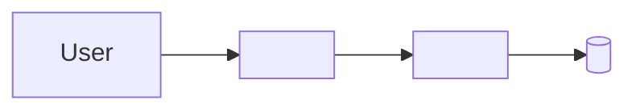

# <System name> architecture

| | |
|---|---|
| **Status** | <draft / current / superseded by …> |
| **Owner** | <team/person> |
| **Last updated** | <YYYY-MM-DD> |

## Summary

<3–5 sentences: what the system does, the main components, the one design choice that most shapes it.>

## Context and goals

- **Problem:** <what this system exists to solve>
- **Goals:** <measurable where possible, e.g. p95 < 200 ms>
- **Non-goals:** <explicitly out of scope>
- **Constraints:** <budget, team, compliance, existing systems>

## High-level design

| Component | Responsibility | Tech | Owns data |
|---|---|---|---|
| <name> | <one line> | <stack> | <tables/buckets> |

## Data flow

<!-- Walk the 1–3 most important flows end to end. -->

### <Flow name, e.g. "User places order">

1. <Component> receives <input>.
2. <Component> <does what>, writes <data> to <store>.
3. <Sync/async> hop to <next component>.

## Integration points

| External system | Direction | Protocol | Failure behaviour |
|---|---|---|---|
| <service> | in/out | <REST/queue/webhook> | <retry, fallback, alert> |

## Key decisions and trade-offs

<!-- Link ADRs if they exist. -->

| Decision | Chosen | Rejected | Why (and cost accepted) |
|---|---|---|---|
| <topic> | <option> | <alternatives> | <reason> |

## Cross-cutting concerns

- **Security:** <auth, secrets, data sensitivity>
- **Reliability:** <failure modes, redundancy, backups>
- **Observability:** <logs, metrics, alerts — links>
- **Scaling:** <current load, known limits, first bottleneck>

## Open questions / risks

- <unresolved item — owner>
