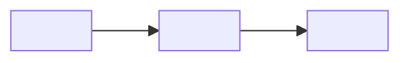

# Onboarding: <team / project>

<One paragraph: what the team builds, who uses it, what a new person will do in their first weeks.>

## Day 1 checklist

- [ ] Accounts: <GitHub org, cloud console, issue tracker, chat> — request via <how>
- [ ] Tools: <OS, editor, CLIs + versions>
- [ ] Read: <2–3 must-read docs, linked, in order>
- [ ] Meet: <buddy / lead>

## Environment setup

<!-- Exact commands. Expected output. Known failures in the table below. -->

1. Clone and install:
   ```bash
   git clone <repo-url>
   cd <repo>
   <install command>
   ```
2. Configure secrets — get values from <where>; never paste them here:
   ```bash
   cp .env.example .env
   ```
3. Run locally:
   ```bash
   <run command>
   ```
   Open <http://localhost:PORT> — you should see <expected>.
4. Run tests:
   ```bash
   <test command>
   ```

**Common setup problems**

| Symptom | Fix |
|---|---|
| <exact error message> | <fix> |

## How the system fits together

<!-- One short diagram or paragraph. Link the architecture doc for depth. -->



| System | What it does | Repo / link |
|---|---|---|
| <name> | <one line> | <link> |

## Common tasks

### Ship a small change

1. Branch: <naming convention>
2. Check: `<lint/test command>`
3. PR: <conventions, reviewers>
4. Deploy: <how, who>

### <Other common task>

1. <step>

## Who to ask

| Topic | Person / channel |
|---|---|
| <area> | <role or #channel> |

## Glossary

| Term | Meaning |
|---|---|
| <jargon> | <plain definition> |

## First tasks

- [ ] <starter issue / good-first-issue link>
- [ ] Fix one thing in this guide that was wrong or unclear
